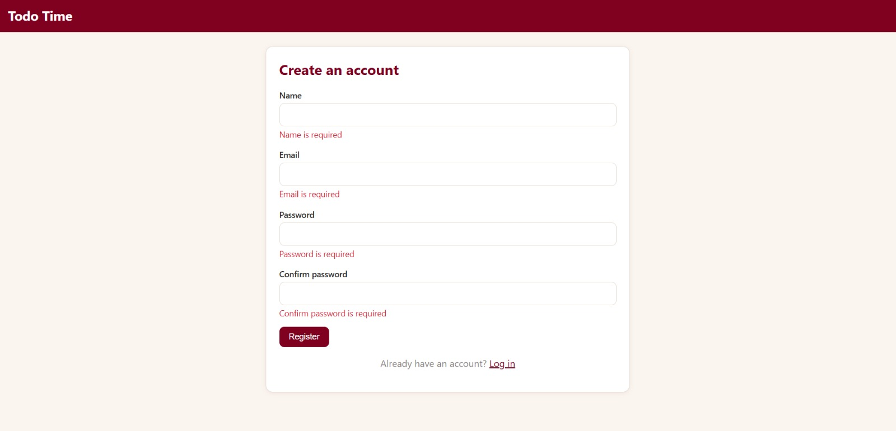
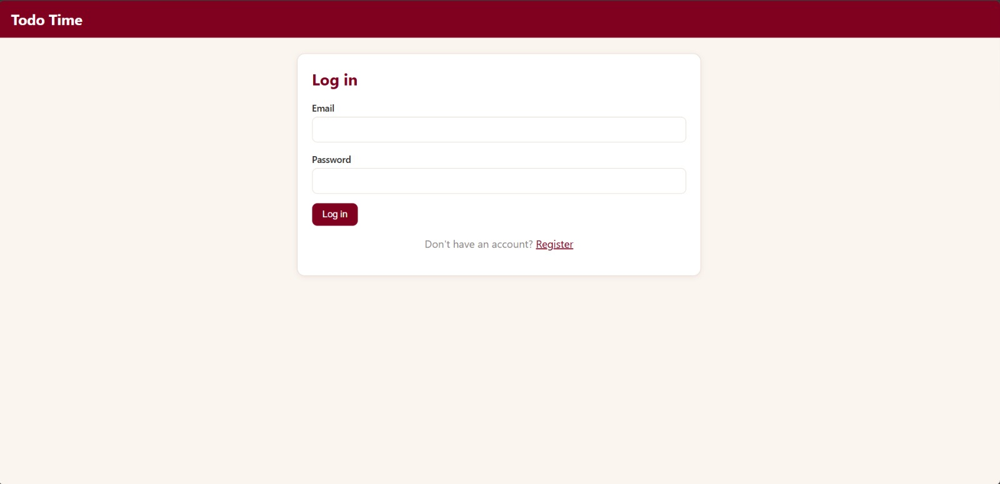
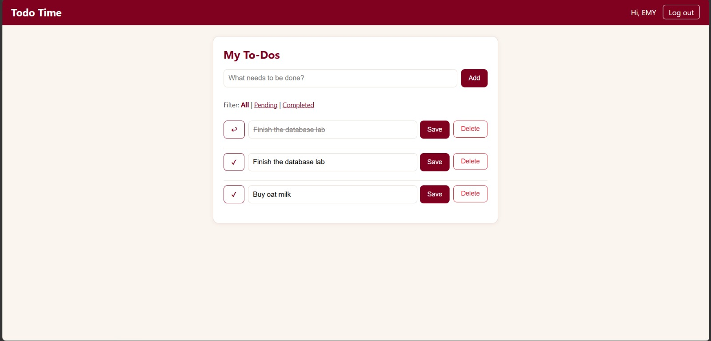
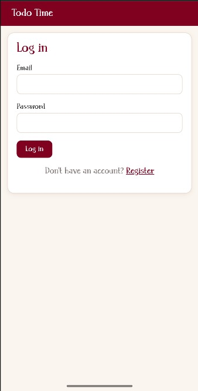

# Todo Time

A simple website where you can sign up, log in, and keep your own to-do list.

**Course:** Introduction to Database Systems, Lab 2 (Fall 2026)
**Faculty of Engineering, Alexandria National University**

---

## 1. Team

| Name | ID | What this person did |
|---|---|---|
| Amal Sabry Farid | 2304112 | Database, server code (Flask), register, login, logout, to-do features |
| Mohamed Ali Mohamed | 2304105 | Page design (CSS), phone layout, browser checks (JavaScript), testing, screenshots |

## 2. Technology

- **Back end:** Python with Flask
- **Front end:** HTML, CSS, and JavaScript
- **Database:** MySQL (database name: `registration`), plain SQL, no ORM
- **Libraries:** flask, pymysql, bcrypt, python-dotenv

## 3. How to run it

1. Install **Python** (tick "Add python.exe to PATH") and **MySQL** with Workbench.
2. Download this project from GitHub.
3. Open MySQL Workbench. Click **File > Open SQL Script**, choose `database/schema.sql`, and run it (Ctrl+Shift+Enter). This creates the database and the two tables.
4. Copy the file `.env.example` and name the copy `.env`. Write your own MySQL password after `DB_PASSWORD=`.
5. Open a terminal in the project folder and run these two commands:

```
pip install -r requirements.txt
python app.py
```

6. Open **http://127.0.0.1:5000** in your browser.

## 4. Features

- **R1 Register:** name, email, password, and confirm password. If the email is already used, it shows `Email Already Exists`. After registering, the user is logged in.
- **R2 Login and Logout:** a wrong email or a wrong password shows the same message: `Invalid email or password`. Logout ends the session.
- **R3 Private list:** if you are not logged in, you are sent to the login page. Each user sees only their own to-dos, newest first.
- **R4 Add** a to-do. **R5 Edit** its title. **R6 Mark** it done or not done. **R7 Delete** it (the site asks "Are you sure?" first).
- **R8 Checks:** the browser checks the form first, and the server checks again. The messages are shown in red next to the field.
- **R9 Safety:** passwords are saved as bcrypt hashes, every value goes to MySQL as a parameter, and the `user_id` always comes from the session.
- **R10 Design:** same style on all pages, works on a phone screen, clear messages, and a friendly text when the list is empty.
- **Bonus:** filter the list (All, Pending, Completed).

## 5. Screenshots

Register page with error messages:





Login page:





To-do list with one finished task:





Phone-sized window:





## 6. Answers

**(a) Why do UPDATE and DELETE contain `AND user_id = ?`, and what changes if you remove it?**

The to-do number comes from the browser, so anyone can send another person's number. With `AND user_id = ?` (the id comes from the session), the command changes nothing if the to-do is not yours. If we remove it, any logged-in user could change or delete other people's to-dos.

**(b) What happens if you insert a to-do for a `user_id` that does not exist? Which constraint is that?**

MySQL refuses it and shows error 1452. This is the **foreign key** constraint. Every to-do must belong to a user that exists.

**(c) Why do you store a hash and not the password?**

If someone gets into the database, they see only hashes, not the real passwords. A hash cannot be turned back into the password. At login, the site hashes the typed password and compares it with the saved hash.

**(d) The `name` column is NOT NULL. Why do you still need your own check for an empty name?**

`NOT NULL` only blocks "no value at all". An empty text `''` is a value, so MySQL accepts it. Only our own check (in JavaScript and on the server) can refuse an empty name and show `Name is required`.
